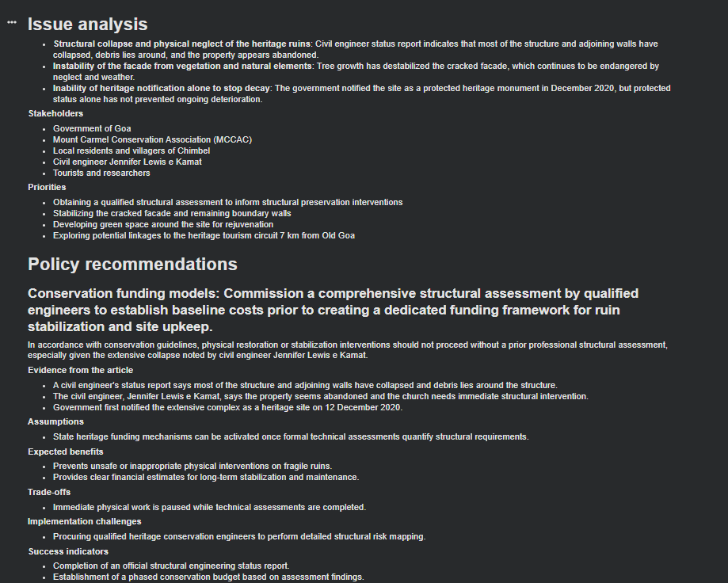
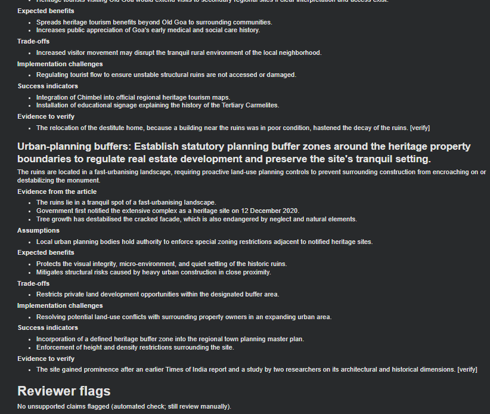
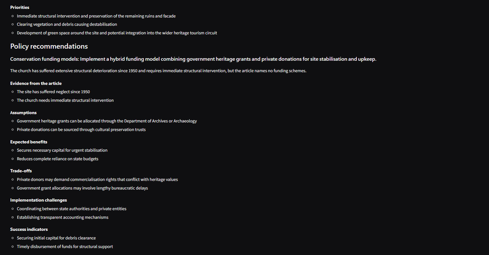
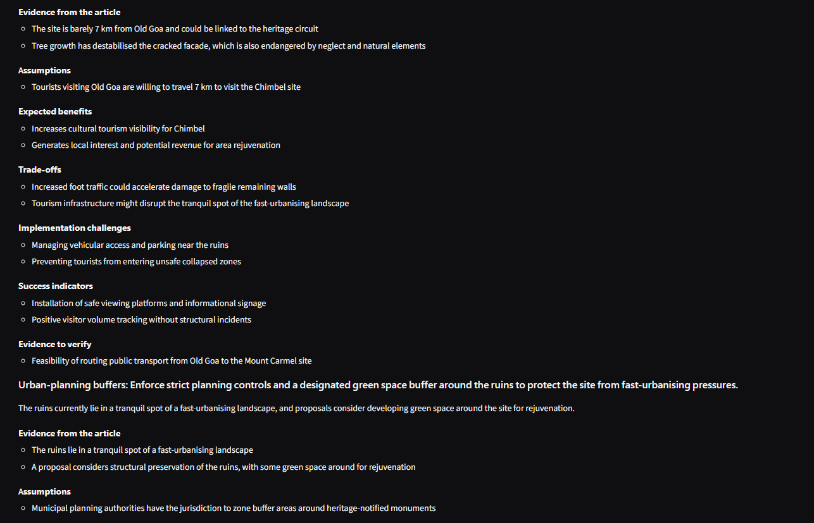
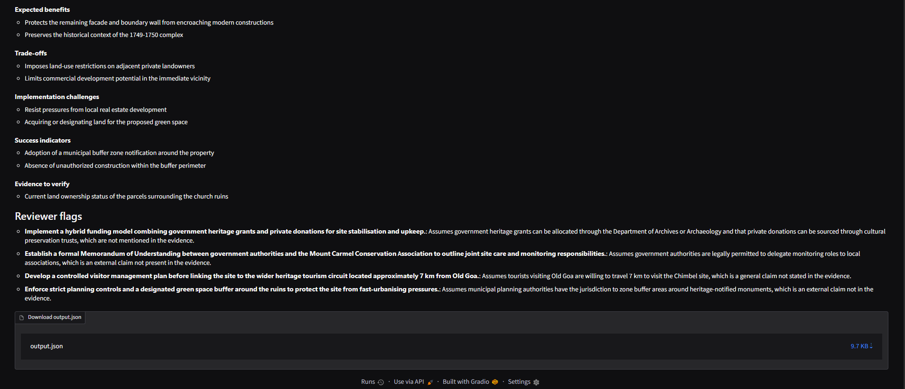

# HeritageGuard AI: Policy Recommendation Agent (Task 3)

Article: Times of India (Goa), "Govt boost for historic Mount Carmel site, locals for urgent conservation".

## Problem
How can a notified but neglected heritage site, the Church of Our Lady of Mount Carmel in Chimbel, Goa, be conserved and made sustainable through community involvement and heritage tourism? The agent analyses the article's issues and recommends government policy options with justification and trade-offs.

## Stack
Python, Gemini API (JSON-schema output; default `gemini-3.5-flash` with fallback models), Google Colab notebook, Gradio interface (Streamlit page also included).

## How the agent works
Three steps: analyse issues -> recommend one option for each of four policy areas (funding, community stewardship, heritage tourism, urban-planning buffers) -> review for unsupported claims. Two local tools load the article facts (`data/article_facts.json`) and the policy areas. Requests have a timeout, and busy-server errors trigger a retry and then a fallback to the next model.

## Design principles
Evidence grounding, assumptions kept separate from article facts, neutrality, human review (structural decisions need qualified experts).

## Output (first version)

Full output: `output/output.json`

## Interface
Gradio page (`gradio_app.py`), launched from Colab with `build_ui().launch(share=True)`. Screenshots below came from the updated agent; the model used is shown on the page.

Full output: `output/output_gradio.json`

## Run on Google Colab
1. Open `HeritageGuard_Agent_Colab.ipynb` in colab.research.google.com.
2. Add a Colab secret named `GEMINI_API_KEY` (key from https://aistudio.google.com) and enable notebook access.
3. Run the cells in order. Upload a zip of this repo when asked, then paste the article text.
4. For the interface: `!pip -q install gradio`, then `from gradio_app import build_ui` and `build_ui().launch(share=True)`.

If a model name fails, set `GEMINI_MODEL` to a name shown in AI Studio.

## Limits
No web browsing or citation checking. Impacts are expectations, not measured results. The automated reviewer is lenient, so outputs need manual checking. `data/article_facts.json` was written from a scan; check the [verify] items.
